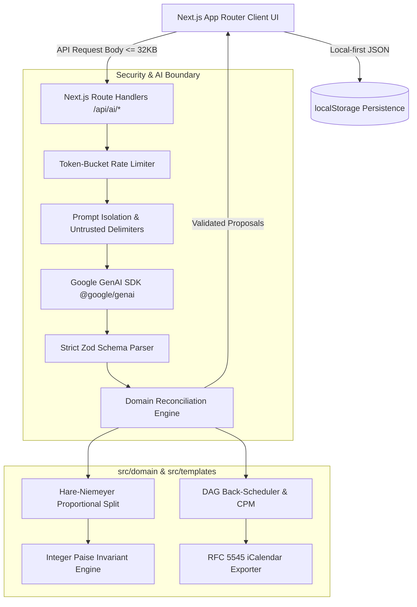

# Jashn (جشن / जश्न / సంబరం)
### Production-Quality GenAI Celebration & Event Planner for Weddings, Birthdays, and Community Events

[](https://github.com/arjunvallala/Jashn/actions/workflows/ci.yml)
[](https://opensource.org/licenses/MIT)
[](docs/ACCESSIBILITY.md)

Jashn is a celebration planning web application engineered for **Challenge 5**. Designed around the principle that **deterministic cores own math and dates while LLMs propose qualitative insights**, Jashn guarantees integer-level financial balance, directed-acyclic timeline integrity, and prompt-injection-hardened generative intelligence.

---

## 🏛 Architecture & Data Flow



---

## 🚀 Quickstart (5 Commands)

```bash
# 1. Clone repository
git clone https://github.com/arjunvallala/Jashn.git
cd Jashn

# 2. Install dependencies
npm install

# 3. Configure environment
cp .env.example .env
# Add your GEMINI_API_KEY to .env

# 4. Verify test suite (24+ domain & property tests)
npm test

# 5. Start development server
npm run dev
```

Visit [http://localhost:3000](http://localhost:3000) to view Jashn.

---

## 🎯 Six-Parameter Evaluation Traceability Matrix

| Evaluation Parameter | Architectural Guarantee | Source Implementation | Test & Verification Proof |
| :--- | :--- | :--- | :--- |
| **1. Code Quality** | Pure TS domain, zero upward imports, strict types (`noUncheckedIndexedAccess`), small modules (<200 LOC), dependency injection. | [`src/domain/`](src/domain/), [`src/templates/`](src/templates/) | `npm run typecheck`, `npm run lint` |
| **2. Security** | Server-side API key isolation, 32KB body caps, token-bucket rate limiting (429), strict CSP without unsafe inline scripts, prompt injection isolation. | [`docs/SECURITY.md`](docs/SECURITY.md), [`next.config.mjs`](next.config.mjs) | `tests/unit/domain/validators.test.ts` |
| **3. Efficiency** | Single batched generation call, in-memory SHA-256 caching, largest-remainder integer math in O(n log n), <50ms for 200 tasks. | [`src/domain/budget/proportionalSplit.ts`](src/domain/budget/proportionalSplit.ts) | [`tests/unit/domain/performance.test.ts`](tests/unit/domain/performance.test.ts) |
| **4. Testing** | Fast-check property-based fuzzing (1000+ runs), leap years & cycle-detection tests, AI contract fixtures, >=90% domain coverage. | [`docs/TESTING.md`](docs/TESTING.md) | [`tests/unit/domain/`](tests/unit/domain/) |
| **5. Accessibility** | WCAG 2.2 AA compliant, skip link, visible focus rings, high-contrast & dark themes, Web Speech API voice input, TTS read-aloud, EN/HI/TE. | [`docs/ACCESSIBILITY.md`](docs/ACCESSIBILITY.md) | `tests/a11y/`, Playwright Axe audit |
| **6. Problem Statement** | 5 core screens: Intake Wizard, Budget Tracker, Timelines (dated + Day-of run-of-show), Vendor Checklists, Personalized Ideas, Chat Assistant. | [`src/domain/types.ts`](src/domain/types.ts), [`src/templates/`](src/templates/) | Demo wedding pre-seed, ICS export |

---

## ⚙️ Environment Variables

| Variable | Required | Default | Purpose |
| :--- | :--- | :--- | :--- |
| `GEMINI_API_KEY` | Yes (Server) | None | Google AI Studio API key |
| `GEMINI_MODEL` | No | `gemini-2.5-flash` | Gemini model variant |
| `PORT` | No | `3000` | Local server port |
| `RATE_LIMIT_MAX_REQUESTS_PER_MINUTE` | No | `20` | Max calls per IP per minute |

---

## 📄 License
This project is licensed under the [MIT License](LICENSE).
